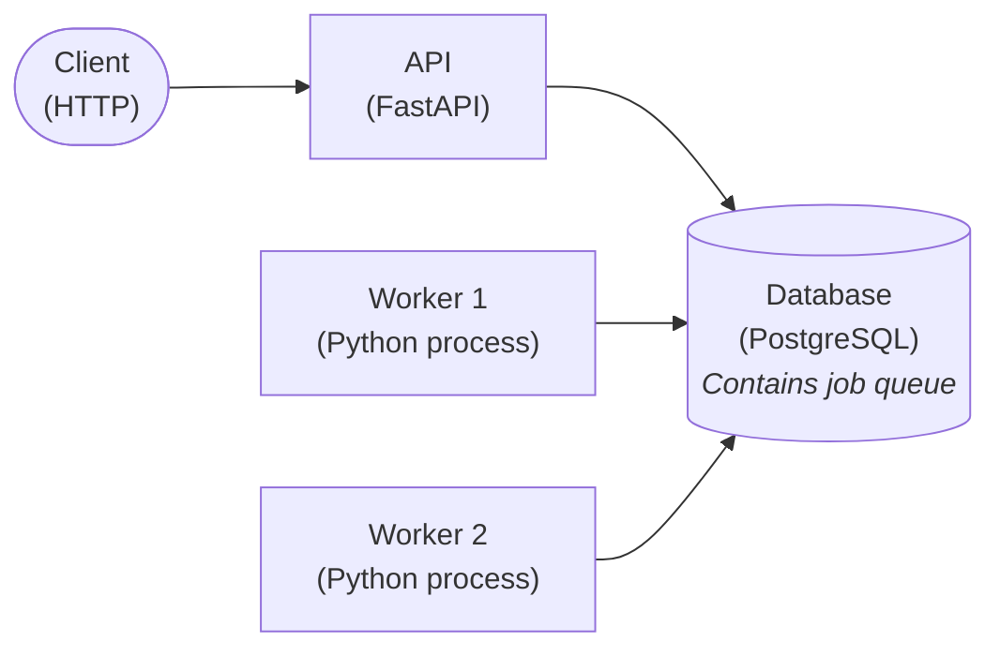

# Grid-Connection-Check

[](https://github.com/lukasgebhard/grid-connection-check/actions/workflows/ci.yml)

A backend service that checks **PV connection requests** against a low-voltage distribution grid. A request such as "30 kW PV at bus 14 of grid X" is approved if the grid can take it, together with everything approved on that grid before. Otherwise it's rejected, with every limit that would be violated.

The service answers **asynchronously**. A check runs a load flow (an electrical simulation of the grid), and requests on the same grid must be decided strictly one after another, because each one changes the grid that the next one is checked against. So the API only stores a request and returns `202 Accepted`. Workers check requests in the background, and the client polls for the verdict.

The grid model is deliberately simple (see [Limitations](#limitations-and-further-ideas)). The focus is the backend design: a job queue in PostgreSQL that checks one request at a time per grid, in submission order, runs different grids in parallel, and survives worker crashes.

> [!TIP]
> To try it out, follow the steps in [walkthrough.md](docs/walkthrough.md).

## Design



All decisions, with their assumptions and consequences, are in [architecture.md](docs/architecture.md).

## Running it

Requirements: Docker. For development also Python 3.14 and [uv](https://docs.astral.sh/uv/).

Copy `.env.sample` to `.env` and adjust the database credentials, then start the database, the API and a worker:

```sh
docker compose up
docker compose up --scale worker=3   # or with several workers
```

The API listens on <http://localhost:8080>; interactive API docs are at <http://localhost:8080/docs>. A worker stops after its current job on `SIGTERM` or `SIGINT`.

| Endpoint | Purpose |
|---|---|
| `POST /connection-requests` | Submit `{grid_id, bus_id, p_kw}`. Returns `202 Accepted`, a `Location` header and the request with `status: "pending"` |
| `GET /connection-requests/{request_id}` | The request with its status (`pending`, `approved`, `rejected` or `failed`) and, once decided, its `result` |
| `GET /livez` | Liveness, no database access |
| `GET /readyz` | Readiness: the database is reachable |

The database schema is a single init script, `db/schema.sql`. PostgreSQL runs it only when the data volume is empty, so after changing it, recreate the database (this deletes all data):

```sh
docker compose down -v
```

## Grids and connection points

Two German low-voltage reference grids (Kerber grids) that ship with pandapower. Connection points are the buses with an existing household load; requests can only target those.

| `grid_id` | Grid |
|---|---|
| `kerber-landnetz-freileitung-1` | Rural overhead-line grid: 13 households on one feeder, 160 kVA transformer |
| `kerber-vorstadtnetz-kabel-1` | Suburban cable grid: 146 households, 630 kVA transformer |

Rural grid: buses 2 to 14 (14 is the far end). Suburban grid: odd buses from 3 to 293. For example requests with curl, see the [walkthrough](docs/walkthrough.md).

## Development and tests

Everything runs from the repository root; the project is not installed as a package.

```sh
uv sync
docker compose up -d db   # the tests need a running database
uv run ruff check --fix .
uv run ruff format .
uv run mypy --strict gridcheck
uv run pytest
```

The tests run against a real PostgreSQL: each run creates a throwaway database from `db/schema.sql` and drops it afterwards, and each test starts with an empty request table. They connect as the user `tester` (with `CREATEDB`), which `db/test_user.sql` creates in the Compose database. That user can't connect to the application database.

Install the pre-commit hook so both Ruff checks run on every commit:

```sh
uv tool install pre-commit
uvx pre-commit install
```

CI (`.github/workflows/ci.yml`) runs Ruff, mypy and pytest against a PostgreSQL 18 service container.

## Limitations and further ideas

**Grid model.** The check is a deliberately simple stand-in for a real connection assessment:

- Reference grids as shipped, fixed topology, no existing generation, stiff upstream grid.
- PV only (active power), one system per request; no consumption requests.
- One static, balanced worst case (no load, full generation); no time series.
- No reactive-power control, curtailment or tap changing.
- Approved requests are permanent.
- Uniform limits; simplified VDE-AR-N 4105 voltage-rise criterion.

**Service.**

- No visible `running` status: a request is `pending` until it's decided ([ADR-005](docs/architecture.md#adr-005-the-job-transaction-stays-open-during-the-load-flow)).
- A request that crashes the worker every time is retried forever and blocks its grid ([ADR-005](docs/architecture.md#adr-005-the-job-transaction-stays-open-during-the-load-flow)).
- No fairness across grids: with fewer workers than busy grids, a long backlog on one grid delays the others ([ADR-007](docs/architecture.md#adr-007-one-request-at-a-time-per-grid-grids-in-parallel)).
- The tests cover a single worker. The concurrency guarantees (one at a time per grid, crash safety) follow from the locking design but are not tested with several worker processes.

**Further ideas.** Consumption requests with a peak-load worst case; time-series simulation; reactive-power control and curtailment; asymmetric load flow; hosting-capacity calculation per bus; editing grid topology; `LISTEN/NOTIFY` instead of polling; an attempt counter against poison pills; concurrency tests with several worker processes; idempotency keys, listing and pagination; Problem Details error responses; authentication; Kubernetes deployment.

## License

[MIT](LICENSE)
